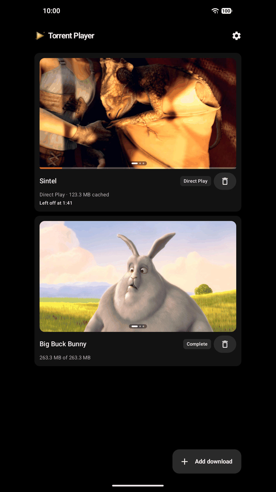
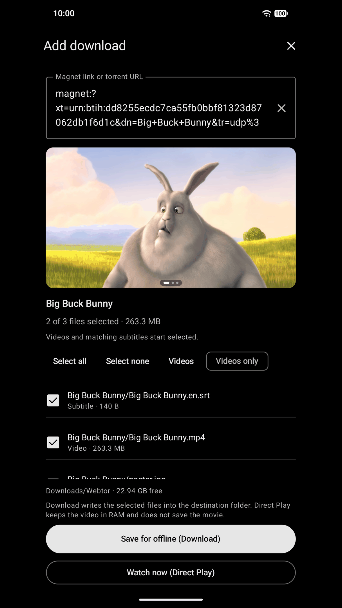
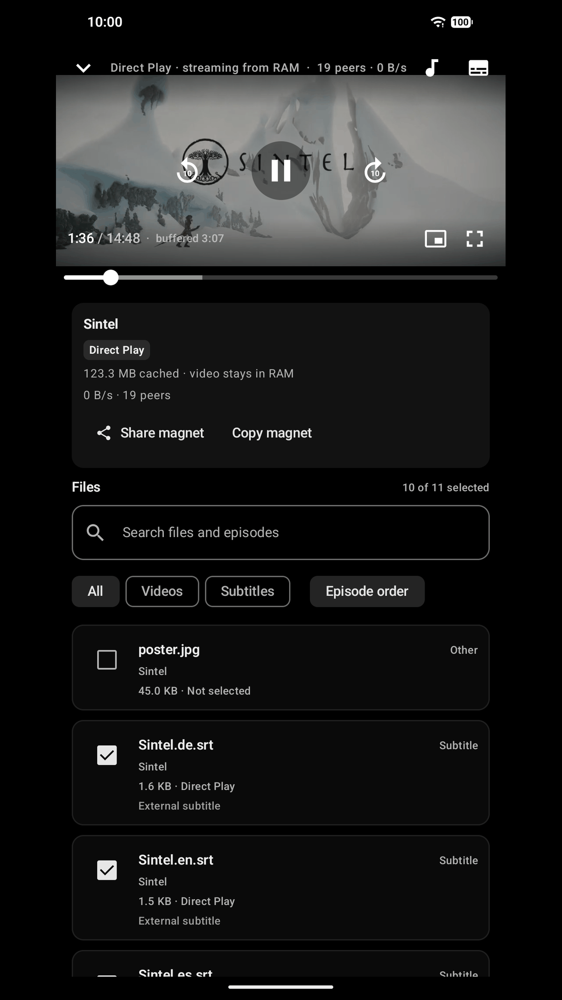
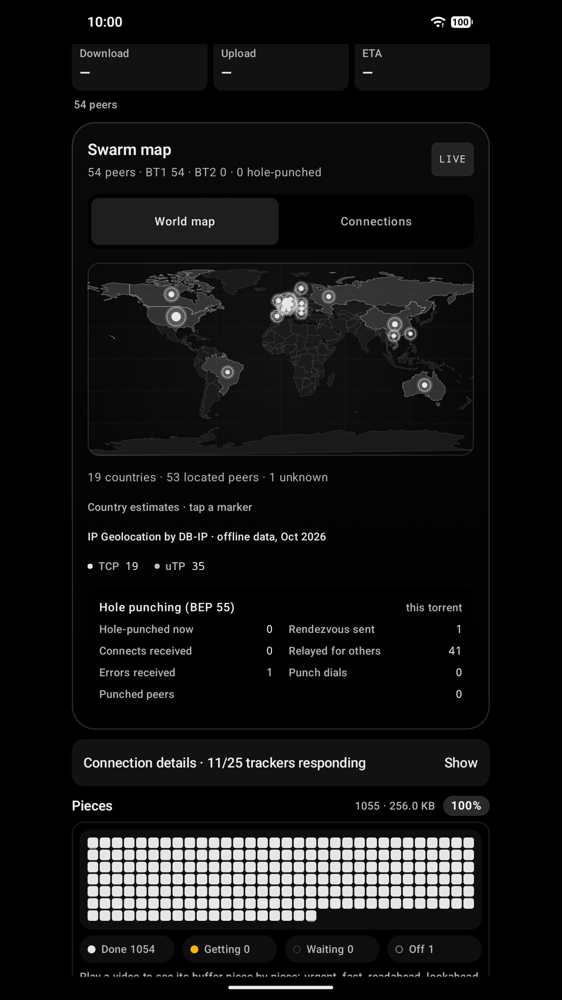
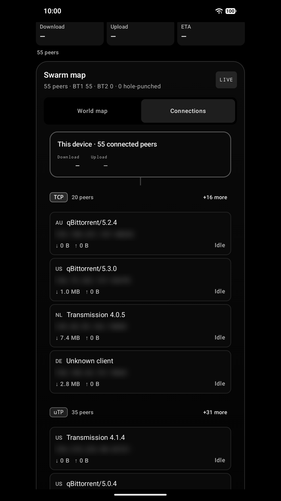

<p align="center">
  
</p>

<h1 align="center">Torrent Player</h1>

<p align="center">
  <strong>Stream and download torrents on Android, with a native Rust engine built for fast seeking.</strong>
</p>

<p align="center">
  <a href="https://f-droid.org/packages/webtor.app/"></a>
  <a href="https://github.com/karmugilen/torrent-player/releases"></a>
  <a href="https://github.com/karmugilen/torrent-player/releases"></a>
  <a href="https://github.com/karmugilen/torrent-player/stargazers"></a>
  <a href="https://developer.android.com"></a>
  <a href="engine-rs"></a>
  <a href="LICENSE"></a>
</p>

<p align="center">
  <a href="https://f-droid.org/packages/webtor.app/"></a>
  <a href="https://github.com/karmugilen/torrent-player/releases/latest"></a>
  <a href="https://apps.obtainium.imranr.dev/redirect?r=obtainium://add/https://github.com/karmugilen/torrent-player"></a>
</p>

<p align="center">
  <a href="#features">Features</a> ·
  <a href="#how-it-compares">How it compares</a> ·
  <a href="#faq">FAQ</a> ·
  <a href="#building-from-source">Build</a>
</p>

<p align="center">
  
  
  
  
  
</p>
<p align="center">
  <sub>Library · Add a torrent · Swarm map and pieces · Peers · Settings<br>
  Shown with <i>Big Buck Bunny</i> and <i>Sintel</i> (&copy; Blender Foundation, CC BY 3.0). Peer IP addresses are hidden.</sub>
</p>

---

## Why Torrent Player

- **Watch right away.** Open a magnet and start playing in VLC, mpv, Just Player or any other video player while the torrent is still downloading.
- **Seeking that keeps up.** Jump anywhere in a video and Torrent Player fetches that spot first, sends late blocks to faster peers and pulls MP4/MKV keyframes ahead.
- **Direct Play.** Stream from a bounded RAM cache without filling your storage. Only a small verified startup cache is kept on disk.
- **Modern swarm.** BitTorrent 2.0, BEP 55 hole punching over IPv4 and IPv6, WebTorrent peers, DHT, PEX and LSD, all in one native Rust engine.
- **Private by design.** No ads, no accounts, no telemetry. The GitHub APK and the F-Droid build carry the same signature.

---

## Features

### Adding torrents
- Paste a magnet, open a `.torrent` file, share one from another app, or open an `http(s)` link ending in `.torrent`.
- Links are fetched in the background (up to 8 MiB). Plain `http://` links are retried over HTTPS on the same host.
- Choose exactly which files, episodes or extras to download from multi-file torrents.
- Adding a torrent that is already in your library opens that entry instead of creating a duplicate.

### Playing
- **Stream while downloading** to any Android video player, or play finished files at any time.
- **Continue watching:** every episode keeps its position.
- **Play next:** when one video ends the next selected one starts, and its opening is fetched in advance.
- **Playlists and subtitles:** episode lists and matching subtitle files are passed to players that support them.
- **Focus on what you watch:** while a player is open, requests go to that file first.
- **Two delivery modes:** *Stream* (default, fastest seeking) or *File proxy* for players that cannot open a stream.

### Downloading and storage
- Save to `Downloads/Webtor` or any folder you choose, including an SD card. Free space is shown for that volume.
- Pick Download or Direct Play as the default, and choose either one when adding a torrent.
- RAM cache is set automatically (64–512 MiB, based on available memory) or by hand from 16 MiB to 1 GiB.
- Peer connection limit from 8 to 500 (default 55).
- No “All files access” permission is needed.

### Sharing back
- Completed downloads seed by default until a share ratio of 1.0 or 60 minutes, at up to 256 KiB/s, on Wi-Fi only, paused during playback. Every limit can be changed in Settings → Seeding.
- While you watch, Direct Play uploads to other peers in the swarm, so clients that reward uploaders send to you sooner.

### Battery and background
- A quiet foreground notification keeps transfers alive and offers **Stop**. During Direct Play it is shown at minimum importance, with no status bar icon.
- Direct Play stops on its own after the player has been closed for a time you set.
- Optional pause on low battery, and a choice of any network, Wi-Fi or unmetered only.
- Background work is sized to your CPU, and the UI updates from engine events instead of polling.

### Swarm insight
- A live world map of approximate peer countries, using a bundled offline DB-IP database (no lookups leave the phone).
- A piece heat grid and a device → protocol → peer diagram.
- Per-torrent counts of BitTorrent v1 and v2 peers, hole-punched peers and BEP 55 activity.

### Look and feel
- Material You colors from your wallpaper on Android 12+, light or dark mode, and four themes: Aero, Antiquity, Retro and Wada.
- Settings are grouped into Downloads, Playback, Network, Seeding, Battery and memory, Appearance, Data and About.

---

## Installation

| Source | Link |
| --- | --- |
| F-Droid | [f-droid.org/packages/webtor.app](https://f-droid.org/packages/webtor.app/) |
| GitHub | [Latest release APK](https://github.com/karmugilen/torrent-player/releases/latest) |
| Obtainium | [Add to Obtainium](https://apps.obtainium.imranr.dev/redirect?r=obtainium://add/https://github.com/karmugilen/torrent-player) for automatic updates from GitHub |

Both are signed with the same key (`CN=Torrent Player`), so either one updates the other in place.

```bash
adb install -r torrent-player-2.4.3.apk
```

- Package: `webtor.app` (arm64-v8a)
- Requires Android 8.0 (API 26) or newer; targets Android 16 (API 36) with 16 KB page support.

---

## Quick start

1. **Add a torrent.** Paste a magnet or link, tap **Open file**, or share a `.torrent` into the app.
2. **Pick files.** Torrent Player loads the file list; tick the files you want. Magnets can be saved before the list arrives.
3. **Choose how to get it.** **Download** saves the files; **Direct Play** streams from RAM.
4. **Press Play.** Android asks which video player to use. Selected subtitle files go along with the video.
5. **Manage it later.** Downloads stay in the library across restarts. **Pause** keeps the files and drops connections; **Delete** asks whether to remove the files too.

---

## How it compares

Torrent Player next to [LibreTorrent](https://github.com/proninyaroslav/libretorrent), [Transmission for Android](https://github.com/AndreyPavlenko/transmissionbtc) and [Transdroid](https://github.com/erickok/transdroid). Each app was checked against its own code or documentation (November 2026).

<details open>
<summary><strong>Features</strong></summary>

✅ supported &nbsp;·&nbsp; ❌ not supported

| Feature | Torrent Player | LibreTorrent | Transmission | Transdroid |
| --- | :---: | :---: | :---: | :---: |
| Runs the swarm on the phone | ✅ | ✅ | ✅ | ❌ |
| Magnets and `.torrent` files | ✅ | ✅ | ✅ | ✅ |
| Selective file download | ✅ | ✅ | ✅ | ✅ |
| Stream to a player while downloading | ✅ | ✅ | ✅ | ❌ |
| Seek-first for external players | ✅ | ❌ | ❌ | ❌ |
| Direct Play (RAM + small disk cache) | ✅ | ❌ | ❌ | ❌ |
| Continue watching | ✅ | ❌ | ❌ | ❌ |
| Play next with prefetch | ✅ | ❌ | ❌ | ❌ |
| Episode playlist + subtitles | ✅ | ❌ | ❌ | ❌ |
| Offline peer world map | ✅ | ❌ | ❌ | ❌ |
| Piece heat / swarm details | ✅ | ❌ | ❌ | ❌ |
| Seeding limits (ratio / time / speed) | ✅ | ✅ | ✅ | ✅ |
| BitTorrent 2.0 | ✅ | ✅ | ❌ | ❌ |
| Native Rust engine | ✅ | ❌ | ❌ | ❌ |
| Create torrents | ❌ | ✅ | ❌ | ❌ |
| RSS / auto-download | ❌ | ✅ | ❌ | ✅ |
| Download scheduling | ❌ | ✅ | ❌ | ❌ |
| IP filtering | ❌ | ✅ | ❌ | ❌ |
| Tracker / peer proxy | ❌ | ✅ | ✅ | ❌ |
| Android TV | ❌ | ✅ | ✅ | ✅ |
| Cast / DLNA / UPnP media server | ❌ | ❌ | ✅ | ❌ |
| 35+ UI languages | ❌ | ✅ | ❌ | ❌ |
| Remote control of a PC/NAS client | ❌ | ❌ | ❌ | ✅ |
| On f-droid.org | ✅ | ✅ | ❌ | ✅ |
| No ads, no telemetry | ✅ | ✅ | ✅ | ✅ |
| GitHub and F-Droid share a signing key | ✅ | ❌ | ❌ | ❌ |

</details>

<details>
<summary><strong>Protocols</strong></summary>

| Protocol | Torrent Player | LibreTorrent | Transmission | Transdroid |
| --- | :---: | :---: | :---: | :---: |
| HTTP(S) and UDP trackers | ✅ | ✅ | ✅ | ❌ |
| WebSocket trackers (WebTorrent) | ✅ | ✅ | ❌ | ❌ |
| DHT | ✅ | ✅ | ✅ | ❌ |
| PEX (peer exchange) | ✅ | ✅ | ✅ | ❌ |
| LSD (same Wi-Fi) | ✅ | ✅ | ✅ | ❌ |
| Cached public tracker list | ✅ | ❌ | ❌ | ❌ |
| TCP and uTP | ✅ | ✅ | ✅ | ❌ |
| WebRTC | ✅ | ✅ | ❌ | ❌ |
| Web seeds (`url-list`) | ✅ | ✅ | ✅ | ❌ |
| Encryption (MSE/PE) | ✅ | ✅ | ✅ | ❌ |
| Extension protocol and Fast extension | ✅ | ✅ | ✅ | ❌ |
| UPnP / NAT-PMP port mapping | ✅ | ✅ | ✅ | ❌ |
| Hole punching (BEP 55) | ✅ | ✅ | ❌ | ❌ |

</details>

**Notes**
- Transdroid is a remote control for a client on a PC or NAS and has no torrent engine of its own, so it has no protocol support of its own.
- Transmission for Android is distributed through IzzyOnDroid and GitHub, not f-droid.org or Google Play.
- *Seek-first* means the swarm fetches the new playhead before anything else and moves late blocks to faster peers. Plain sequential download is not the same.
- *Seeding limits*: Torrent Player stops seeding by ratio, time or speed. For LibreTorrent and Transdroid the row means speed and related controls.

---

## Under the hood

```
┌─────────────────────────────────────────────────────────────┐
│                     Android app (Kotlin)                    │
│    Jetpack Compose · Material 3 · foreground service        │
│    library · storage · external-player intents              │
└──────────────────────────────┬──────────────────────────────┘
                               │ in-process JNI: commands and events
┌──────────────────────────────▼──────────────────────────────┐
│                 Torrent engine (Rust, engine-rs)            │
│   wt-types → wt-meta → wt-wire / wt-discovery → wt-core     │
│                       → wt-engine (libengine.so)            │
│   TCP · uTP · WebRTC · DHT · PEX · LSD · BEP 55 · BEP 52    │
└─────────────────────────────────────────────────────────────┘
```

**Android app** (`android/app`, `android/core`)
- Owns the foreground service, notifications, player intents, library and folder storage.
- Talks to the engine in-process over JNI. `.torrent` files are passed as raw bytes; there is no local control server.

**Engine** (`engine-rs`)
- A pure Rust shared library, and the only engine the app ships since 2.4.0.
- Playback scheduling serves the playhead first (about 2 MiB), then readahead (about 24 MiB), lookbehind, and rarest-first in the background.
- Seeks cancel stale requests, hedge stuck playhead blocks to other peers and yield slow peers.
- On BitTorrent 2.0 torrents, 16 KiB leaf hashes let seek data be verified before its whole piece arrives.
- Hole punching runs over uTP on IPv4 and IPv6. Symmetric NATs and carrier-grade NAT (common on mobile data) can still block it.
- Videos reach players through a loopback HTTP stream or, in File proxy mode, a read-only content URI over verified data.

**Reproducible releases**
- Every published APK is built inside F-Droid’s own build image by `scripts/fdroid-release.sh`, signed, and checked with F-Droid’s `verify_apks`.
- F-Droid rebuilds the same tag and publishes only when its build matches the GitHub APK byte for byte (see [`webtor.app.yml`](webtor.app.yml)).

More detail: [Direct Play](docs/DIRECT_PLAY.md) · [Signing](docs/SIGNING.md) · [F-Droid submission](docs/FDROID_SUBMISSION.md) · [Privacy](PRIVACY.md)

---

## Building from source

**You need**
- Linux and Git
- Rust **1.99.1** via rustup, with target `aarch64-linux-android` and `~/.cargo/bin` on `PATH`
- Android SDK (platforms 34 and 36, build-tools 34+) and NDK **26.1.10909125**
- Java 21

**Debug build**

```bash
cd android
JAVA_HOME=/usr/lib/jvm/java-21-openjdk \
  ANDROID_HOME=$HOME/Android/Sdk \
  ANDROID_NDK_HOME=$HOME/Android/Sdk/ndk/26.1.10909125 \
  ./gradlew :app:assembleDebug --no-daemon
adb install -r app/build/outputs/apk/debug/app-debug.apk
```

Gradle builds the Rust engine (`engine-rs/build-android.sh`) and packages `libengine.so` for you. No Go, Node.js or JavaScript toolchain is needed.

**Tests**

```bash
cd android && ./gradlew :app:testDebugUnitTest :core:test --no-daemon -x buildRustEngine
cd engine-rs && cargo test --workspace
```

**Release builds:** a local `assembleRelease` is fine for testing on your own phone. Published GitHub and F-Droid builds must come from `scripts/fdroid-release.sh` so they match F-Droid’s rebuild.

---

## FAQ

<details>
<summary><strong>Which video players work?</strong></summary>

Any player that opens Android video links. VLC, mpv, Just Player and Nova Player all work, and players that accept playlists, subtitles and resume positions get those too. If a player cannot open the stream, switch Settings → Playback → *How players get the video* to **File proxy**.
</details>

<details>
<summary><strong>Does it use mobile data?</strong></summary>

Downloads run on any network by default; you can limit them to Wi-Fi or unmetered networks in Settings → Network. Seeding finished downloads is Wi-Fi only by default.
</details>

<details>
<summary><strong>Will Direct Play fill up my storage?</strong></summary>

No. Direct Play keeps video in a bounded RAM cache and saves only a small verified startup cache on disk, so you can watch large files on a nearly full phone.
</details>

<details>
<summary><strong>Why do transfers stop in the background after a while?</strong></summary>

Recent Android versions allow apps about 6 hours a day of background data transfer. Torrent Player shows a notification when that happens; opening the app continues the transfers.
</details>

<details>
<summary><strong>Does it collect any data?</strong></summary>

No. There are no ads, accounts, analytics or crash reporters. Peer country lookup uses an offline database inside the app. See the [privacy policy](PRIVACY.md).
</details>

<details>
<summary><strong>Which devices are supported?</strong></summary>

Phones and tablets on Android 8.0 or newer with a 64-bit ARM processor (arm64-v8a), which covers almost every phone sold since 2017. No root needed.
</details>

<details>
<summary><strong>Is it legal?</strong></summary>

BitTorrent is a legal technology used to share Linux distributions, open films, games and datasets. What you download is your responsibility; use Torrent Player only with content you have the right to share.
</details>

---

## Contributing and support

- **Found a bug or want a feature?** [Open an issue](https://github.com/karmugilen/torrent-player/issues/new). Include your Android version, phone model and, if possible, the magnet of a legal test torrent.
- **Pull requests are welcome.** Run the tests in [Building from source](#building-from-source) first.
- **Like the app?** Star the repo and tell a friend. It helps more people find a private, open source way to stream torrents.

---

## What’s new

Full notes are on [GitHub Releases](https://github.com/karmugilen/torrent-player/releases).

- **2.4.3**: Hole punching starts right away for peers behind routers and now works over IPv6. Direct Play gives back to the swarm while you watch and serves only verified video headers. Quieter Direct Play notification, and notification permission is asked when the app opens.
- **2.4.2**: BitTorrent 2.0 (hybrid and pure v2), BEP 55 hole punching, BT1/BT2 and hole-punch counts in Connections, and a lighter app ↔ engine link.
- **2.4.1**: `.torrent` files and download links, free space shown per volume (including SD cards), tidier settings.
- **2.4.0**: The Rust engine replaces Go, with faster seek scheduling.

---

## Star history

<p align="center">
  <a href="https://star-history.com/#karmugilen/torrent-player&Date">
    <picture>
      <source media="(prefers-color-scheme: dark)" srcset="https://api.star-history.com/svg?repos=karmugilen/torrent-player&type=Date&theme=dark" />
      
    </picture>
  </a>
</p>

If Torrent Player is useful to you, a star helps others find it.

---

## Legal

Use Torrent Player only with content you have the right to download or share. Screenshots and test fixtures use open Creative Commons films (*Big Buck Bunny* and *Sintel* &copy; Blender Foundation, [CC BY 3.0](https://creativecommons.org/licenses/by/3.0/)).

## License

The app is released under the [MIT License](LICENSE). The torrent engine in `engine-rs/` is under the [Mozilla Public License 2.0](engine-rs/LICENSE), because it derives from [anacrolix/torrent](https://github.com/anacrolix/torrent); see [engine-rs/NOTICE.md](engine-rs/NOTICE.md).
