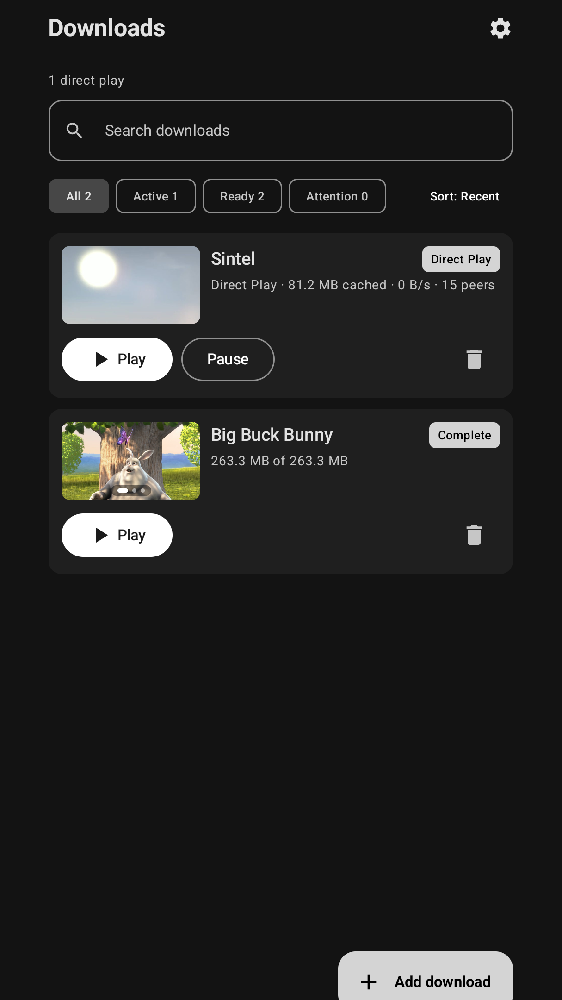
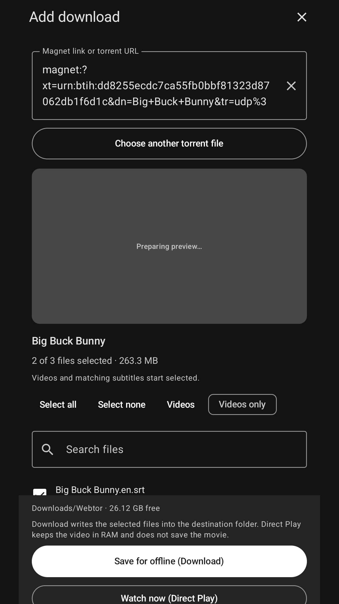
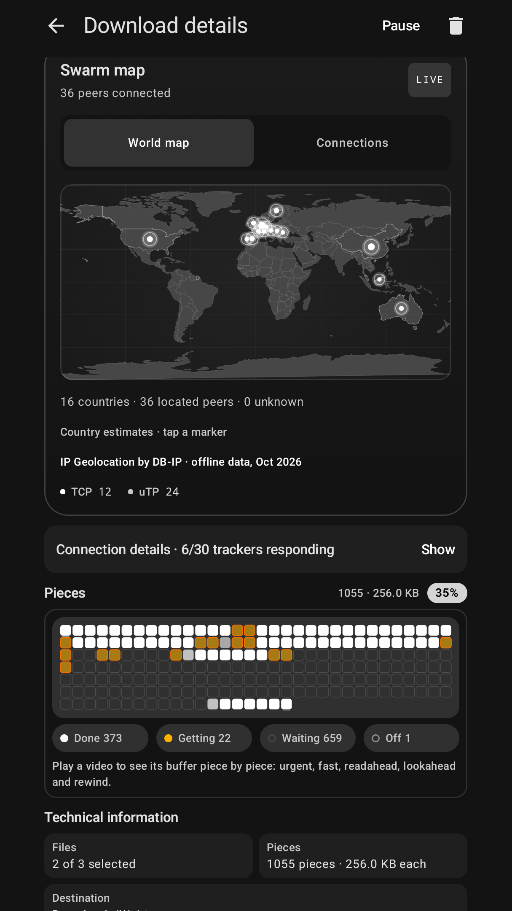
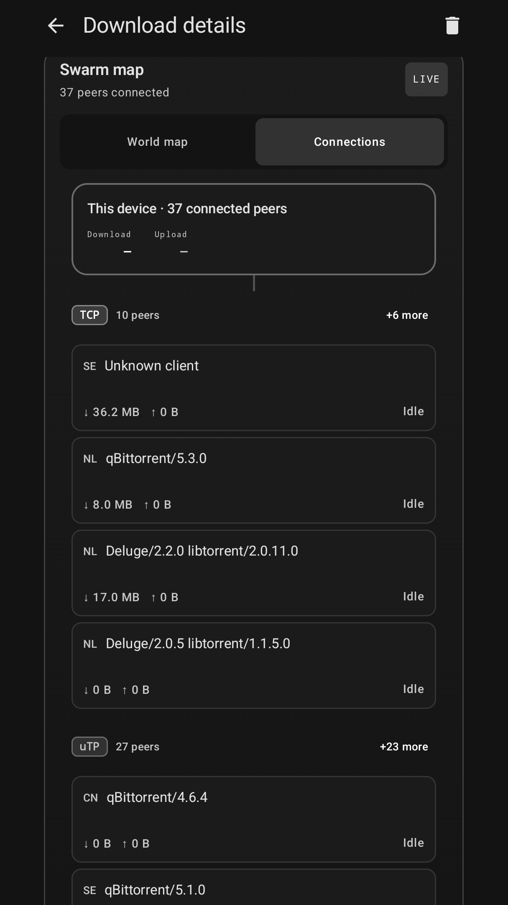
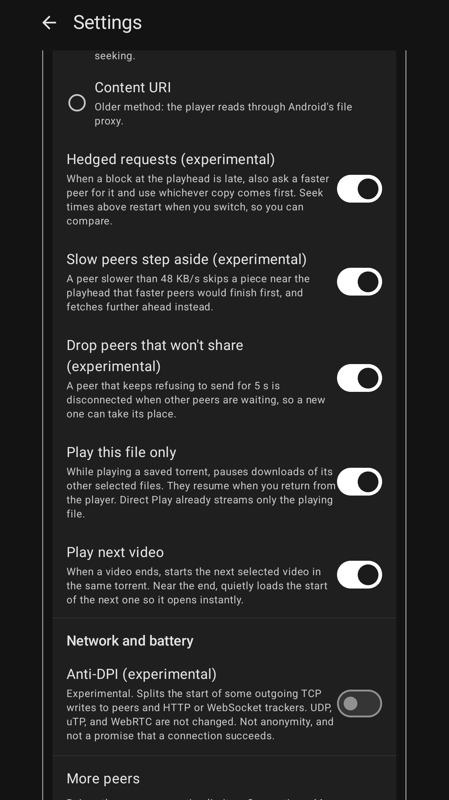

# Torrent Player

<p align="center">
  
  <h2 align="center">Torrent Player</h2>
  <p align="center">
    <strong>Fast, native, battery-friendly torrent downloader and streaming player for Android.</strong>
  </p>
  <p align="center">
    <a href="https://developer.android.com"></a>
    <a href="https://m3.material.io"></a>
    <a href="engine-rs"></a>
    <a href="LICENSE"></a>
    <a href="https://github.com/karmugilen/torrent-player/releases"></a>
    <a href="https://f-droid.org/packages/webtor.app/"></a>
  </p>
</p>

---

## Screenshots

<p align="center">
  
  
  
  
  
</p>
<p align="center">
  <sub>Library and previews · Add a torrent · Swarm map and pieces · Peers · Settings<br>
  Shown with <i>Big Buck Bunny</i> and <i>Sintel</i> (&copy; Blender Foundation, CC BY 3.0). Peer IP addresses are hidden.</sub>
</p>

---

## Key Features

- **Magnets, `.torrent` files, and download links**: Paste a magnet, open a local `.torrent`, share a file from another app, or open an `http(s)` link that ends in `.torrent`. Links are fetched in the background (up to 8 MiB); plain `http://` links are tried over HTTPS on the same host. A torrent already in the library opens that entry instead of adding a duplicate.
- **Two storage choices**: Download selected files to `Downloads/Webtor` (or a folder you pick, including an SD card) for offline use, or choose **Direct Play** to keep video in bounded RAM and save only a small verified startup cache. Choose the default in Settings; both actions remain available when adding a torrent. Free space in Settings is measured on the volume of the chosen folder, so an SD card shows its own free space.
- **RAM cache and peers**: Settings offers Auto RAM or a manual cache limit from 16 MiB to 1 GiB per transfer, and a peer connection limit from 8 to 500 (default 55). Auto chooses 64–512 MiB from available memory and active transfers when starting, returning to the app, or configuring a transfer. Both settings survive restarts and apply to active and future transfers. Cache reductions take effect as pieces are replaced; preview tasks keep a separate memory budget.
- **Fast seeking**: A seek stops downloads for the old place and fetches the new spot first, then the following blocks in order. Late blocks move to faster peers. For MP4 and MKV files, nearby keyframes are fetched ahead. Use **How players get the video → Stream** in Settings for the fastest seeks; File proxy is the fallback when a player cannot open the stream.
- **Continue watching & Play next**: Saved positions for every episode, and the next selected video starts when one ends, with its start fetched in advance. Playing one file of a saved torrent focuses requests on that file until you return from the player.
- **Seeding on by default**: Completed downloads share verified pieces until a share ratio of 1.0 or 60 minutes, at up to 256 KiB/s, only on Wi-Fi, and paused during playback. All limits, or seeding itself, can be changed in Settings → Seeding.
- **In-progress streaming**: Launch your favorite Android video player (VLC, Nova Player, Just Player, MPV, and others) while downloading, or play finished videos anytime. Episode playlists, matching selected subtitles, and resume positions work with players that support the usual Android intent contracts.
- **Selective downloads**: Choose exactly which files, episodes, or extras to download from multi-file torrents.
- **Battery-friendly**:
  - Native Rust engine with bounded preparation and piece-boundary storage. Direct Play prioritizes opening/container pieces, adapts forward buffering to reader consumption, parks idle probes, and retries stalled reads through the peer scheduler.
  - CPU-sized background workers validate startup caches and hash independent pieces across available cores. Direct Play entries stay paused on app startup. See [playback and cache behavior](docs/DIRECT_PLAY.md).
  - Pause on low battery is off by default (a saved choice is kept). Idle Direct Play can stop after a timeout you set.
  - Native change notifications update the UI without repeated control HTTP requests. Transfer telemetry uses the engine's one-second sampling clock.
- **Material You UI**: Wallpaper-based colours on Android 12+, light/dark appearance, and four themes (Aero, Antiquity, Retro, Wada). Settings are grouped into Downloads, Playback, Network, Seeding, Battery and memory, Appearance, Data, and About. One Clear action covers engine caches.
- **Cached public trackers**: A small maintained tracker list refreshes daily in the background. The last good cache works offline, supplied trackers stay intact, and extra trackers are added only after public metadata is available. WebSocket signaling trackers remain enabled.
- **Full swarm connectivity**: Finds peers via DHT, PEX, LSD, HTTP(S)/UDP trackers, and WebTorrent WebSocket trackers; moves data over TCP, native uTP, and WebRTC data channels (plus HTTP(S) web seeds when listed).
- **Live connection maps**: Download details offers a world map of approximate peer countries and an expandable device/protocol/peer diagram. Country lookup uses a bundled offline DB-IP database; unknown and local addresses stay unlocated. Maps refresh once per second while details is open; pause clears peer connections.

---

## Compared with other Android torrent apps

Torrent Player (**Mine**) vs [LibreTorrent](https://github.com/proninyaroslav/libretorrent), [Transmission for Android](https://github.com/AndreyPavlenko/transmissionbtc), and [Transdroid](https://github.com/erickok/transdroid).

Yes / No only. Transdroid has no local swarm (it controls a PC/NAS client), so many rows are **No** there.

### Features

| Feature | Mine | LibreTorrent | Transmission | Transdroid |
| --- | :---: | :---: | :---: | :---: |
| Local swarm on the phone | Yes | Yes | Yes | No |
| Magnets | Yes | Yes | Yes | No |
| `.torrent` files | Yes | Yes | Yes | No |
| Selective file download | Yes | Yes | Yes | No |
| Stream while downloading | Yes | Yes | Yes | No |
| Seek-first for external players | Yes | No | No | No |
| Direct Play (RAM + small disk cache) | Yes | No | No | No |
| Continue watching | Yes | No | No | No |
| Play next + prefetch | Yes | No | No | No |
| Episode playlist + selected subtitles | Yes | No | No | No |
| Offline peer world map | Yes | No | No | No |
| Piece heat / swarm details | Yes | No | No | No |
| Seeding limits | Yes | Yes | Yes | No |
| Create torrents | No | Yes | No | No |
| RSS / auto-download | No | Yes | No | Yes |
| Download scheduling | No | Yes | No | No |
| IP filtering | No | Yes | No | No |
| Tracker / peer proxy | No | Yes | Yes | No |
| Android TV | No | Yes | No | No |
| Cast / DLNA / UPnP to TV | No | No | Yes | No |
| 35+ UI languages | No | Yes | No | Yes |
| Remote-control PC/NAS client | No | No | No | Yes |
| Native Rust engine | Yes | No | No | No |
| F-Droid | Yes | Yes | No | Yes |
| No ads | Yes | Yes | Yes | Yes |
| No telemetry | Yes | Yes | Yes | Yes |
| GitHub and F-Droid same signing key | Yes | No | No | No |

### Protocols (find peers + move data)

| Protocol | Mine | LibreTorrent | Transmission | Transdroid |
| --- | :---: | :---: | :---: | :---: |
| HTTP(S) trackers | Yes | Yes | Yes | No |
| UDP trackers | Yes | Yes | Yes | No |
| WebSocket trackers (WebTorrent) | Yes | Yes | No | No |
| DHT | Yes | Yes | Yes | No |
| PEX (peer exchange) | Yes | Yes | Yes | No |
| LSD (LAN / same Wi‑Fi) | Yes | Yes | Yes | No |
| Public tracker list cache | Yes | No | No | No |
| TCP | Yes | Yes | Yes | No |
| uTP (µTP) | Yes | Yes | Yes | No |
| WebRTC | Yes | Yes | No | No |
| WebSeed (HTTP(S) piece URLs) | Yes | Yes | No | No |
| Encryption (MSE/PE) | Yes | Yes | Yes | No |
| LTEP extension protocol | Yes | Yes | Yes | No |
| Fast extension | Yes | Yes | Yes | No |
| UPnP / NAT-PMP port mapping | Yes | Yes | Yes | No |
| Hole punching (BEP 55) | No | Yes | No | No |

## Installation

Install from [F-Droid](https://f-droid.org/packages/webtor.app/), or download the APK from [GitHub Releases](https://github.com/karmugilen/torrent-player/releases). Both are signed with the same key (`CN=Torrent Player`), so either one updates the other in place.

```bash
# Replace with the asset name from the release, e.g. torrent-player-2.4.1.apk
adb install -r torrent-player-2.4.1.apk
```

Package id is `webtor.app` (arm64-v8a). Minimum Android 8.0 (API 26); current releases target Android 16 (API 36) with 16 KB page support.

---

## Using the App

1. **Add a torrent**
   - Paste a magnet, use **Paste link** / **Open file** on an empty library or add sheet, share a `.torrent` into the app, or open an `http(s)` `.torrent` link.
   - The app loads metadata and shows the file selection sheet. Only magnets can be saved before the file list arrives.
2. **Select files and destination**
   - Choose which files to download. Default location is `Downloads/Webtor`; change it under Settings → Downloads (including an SD card). Free space shown there is for that volume.
   - A fresh install does not need broad “All Files Access.”
3. **Download or Direct Play**
   - **Download** saves the selected files. **Direct Play** streams from a bounded RAM cache and keeps only a small verified startup cache on disk.
   - Select matching subtitle files with the video for players that accept them.
   - **Play** on any video opens Android’s app picker for in-progress or completed files.
4. **Library**
   - Downloads stay in the library across restarts. Metadata-only entries stay paused until you choose Download. Details has Play/Continue in the summary.
5. **Background controls**
   - **Pause** stops swarm connections and keeps files. **Delete** can keep or erase files on disk (with Cancel).
   - The foreground notification keeps transfers alive and offers **Stop**.
6. **Settings worth knowing**
   - **How players get the video**: Stream (default, fastest seeking) or File proxy (compatibility).
   - **Stop idle Direct Play**: frees RAM after the player has been closed for a while.
   - **Transfer on**: Any network, Wi-Fi, or unmetered.
   - **Clear**: one action for reclaimable engine caches (sizes are reported from disk).

---

## Architecture & Swarm Engine

```
┌─────────────────────────────────────────────────────────────┐
│                 Android Application Layer                   │
│      Jetpack Compose (Material 3) • Foreground Service      │
│     LibrarySession • TorrentFetch • Storage Management      │
└──────────────────────────────┬──────────────────────────────┘
                               │ Direct JNI commands and events
┌──────────────────────────────▼──────────────────────────────┐
│                    Swarm Engine Runtime                     │
│              Native Rust engine (engine-rs)                 │
│         wt-types → wt-meta → wt-wire / wt-discovery         │
│              → wt-core → wt-engine (cdylib)                 │
│            TCP • uTP • WebRTC • DHT • PEX                  │
└─────────────────────────────────────────────────────────────┘
```

### Android host (`android/app/`, `android/core/`)

- Kotlin + Jetpack Compose (Material 3).
- Owns the foreground service, notifications, external-player intents, library persistence, and folder/SAF storage.
- `TorrentFetch` reads local `.torrent` bytes or downloads a link on an IO dispatcher, then posts base64 `torrentData` to the engine (magnets and info hashes still go as before).
- `EngineClient` talks to the native engine over the in-process JNI control surface (JSON settings and torrent commands). There is no OkHttp control client and no Android listener on port 18080.

### Engine runtime (`engine-rs/`)

- Pure Rust shared library (`libengine.so`); the only engine the app ships since 2.4.0.
- Crate layout (dependency order): `wt-types` → `wt-meta` → `wt-wire` / `wt-discovery` → `wt-core` → `wt-engine`, with `wt-storage` / `wt-policy` on the types/meta side.
- Protocols: TCP, native uTP, WebRTC/WebTorrent-compatible peers, DHT, PEX, HTTP and WebSocket trackers.
- Playback scheduling prioritizes the playhead (about 2 MiB Now), then readahead (~24 MiB), lookbehind, and background rarest-first. Seeks cancel obsolete requests and move late playhead blocks to faster peers; MP4/MKV keyframe hints are fetched ahead when the container index is available.
- Built-in playback aids (always on, not separate Settings toggles): hedged requests for stuck playhead blocks, slow-peer yield, dropping chokers, play-this-file-only while an external player is open, and play-next with start prefetch.
- Playback method: **Stream** (default) gives the player a loopback HTTP media URL for incomplete video and Direct Play; **File proxy** uses a read-only content URI over a seekable descriptor on verified reads. Completed downloads open from the saved file either way.
- A loopback HTTP media endpoint remains for player compatibility. The standalone `engine-host` binary still exposes an HTTP control adapter for desktop development.

### Releases and reproducibility

- GitHub release APKs are built inside F-Droid’s `buildserver` image (`scripts/fdroid-release.sh`), signed with the release key and `--alignment-preserved`, then checked with F-Droid’s `verify_apks`.
- F-Droid rebuilds the same tag, copies the GitHub APK’s signature onto its build, and publishes only if they match (`Binaries:` + `AllowedAPKSigningKeys` in [`webtor.app.yml`](webtor.app.yml)).
- Details: [F-Droid submission](docs/FDROID_SUBMISSION.md), [signing](docs/SIGNING.md), [Direct Play](docs/DIRECT_PLAY.md), [privacy](PRIVACY.md).

---

## Building from Source

### Prerequisites

- Linux and Git
- Rust via rustup, toolchain **1.99.1** (matches releases), target `aarch64-linux-android`
- Android SDK (platforms 34/36), build-tools 34+, NDK **26.1.10909125**
- Java 21 recommended (`JAVA_HOME`); set `ANDROID_HOME` / `ANDROID_NDK_HOME`
- Put `~/.cargo/bin` on `PATH` so Gradle finds rustup’s cargo

### Debug build

```bash
cd android
JAVA_HOME=/usr/lib/jvm/java-21-openjdk \
  ANDROID_HOME=$HOME/Android/Sdk \
  ANDROID_NDK_HOME=$HOME/Android/Sdk/ndk/26.1.10909125 \
  ./gradlew :app:assembleDebug --no-daemon
adb install -r app/build/outputs/apk/debug/app-debug.apk
```

Gradle’s `preBuild` runs `engine-rs/build-android.sh` (`cargo build --locked --release --target aarch64-linux-android`) and packages `libengine.so`. No Go, Node.js, npm, V8, or JavaScript bundle is required.

### Release / F-Droid-shaped APK

Local `assembleRelease` is fine for sideload testing. Published GitHub and F-Droid builds must come from `scripts/fdroid-release.sh` so the binary matches F-Droid’s rebuild. See [docs/FDROID_SUBMISSION.md](docs/FDROID_SUBMISSION.md).

Useful checks:

```bash
cd android
./gradlew :app:testDebugUnitTest :core:test --no-daemon -x buildRustEngine
```

---

## What’s new

See [GitHub Releases](https://github.com/karmugilen/torrent-player/releases) for full notes. Recent highlights:

- **2.4.1** — `.torrent` files and download links; free space on the chosen volume (including SD cards); settings cleanup; seek A/B UI removed.
- **2.4.0** — Rust engine replaces Go; faster seek scheduling; seeding defaults and store text updated for the Rust stack.

---

## Disclaimer & Legal

Use this application only with torrents and media you have the legal right to download or distribute. Development fixtures are open-source Creative Commons videos (*Big Buck Bunny* and *Sintel* &copy; Blender Foundation, [CC-BY](https://creativecommons.org/licenses/by/3.0/)).

---

## License

The app is licensed under the [MIT License](LICENSE). The torrent engine in
`engine-rs/` is licensed under the [Mozilla Public License 2.0](engine-rs/LICENSE),
because it derives from [anacrolix/torrent](https://github.com/anacrolix/torrent);
see [engine-rs/NOTICE.md](engine-rs/NOTICE.md).
