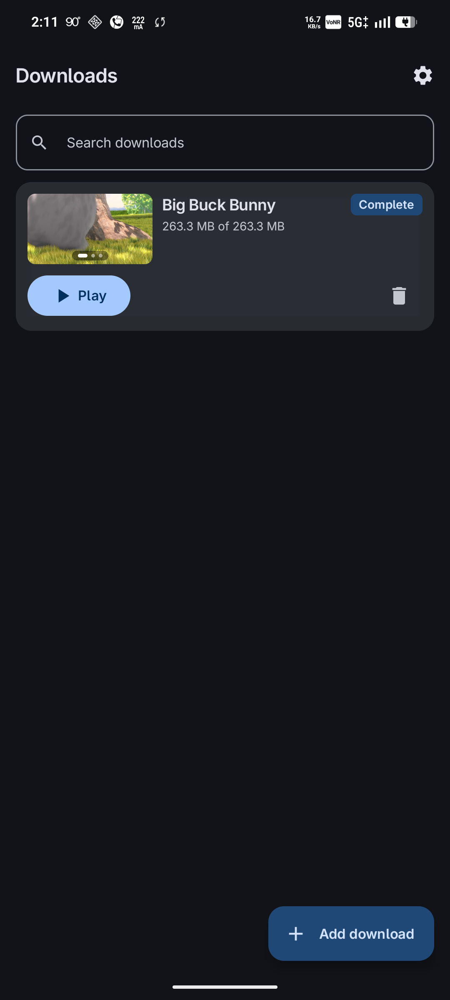
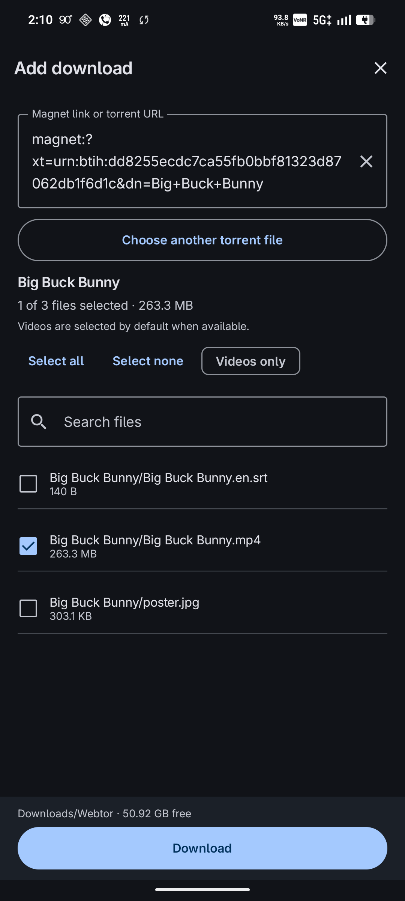
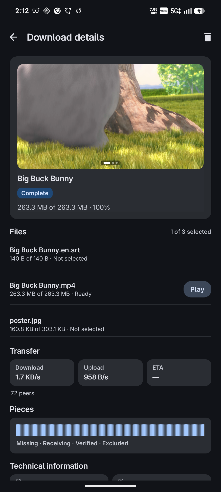

# Torrent Player

<p align="center">
  
  <h2 align="center">Torrent Player</h2>
  <p align="center">
    <strong>Fast, native, battery-friendly torrent downloader and streaming player for Android.</strong>
  </p>
  <p align="center">
    <a href="https://developer.android.com"></a>
    <a href="https://m3.material.io"></a>
    <a href="https://github.com/anacrolix/torrent"></a>
    <a href="LICENSE"></a>
    <a href="https://github.com/karmugilen/torrent-player/releases"></a>
  </p>
</p>

---

## Local redesign

See [the 2.1.3 UI, playback and improvement notes](README_REDESIGN.md) for dynamic Material UI, live cached thumbnails, playback continuity, the branching peer view, caches, storage repair and the optimized local release.

## Desktop discovery webpage

Run `./scripts/discovery.sh start` and open [Torrent Atlas](http://127.0.0.1:18181)
for a live world map and public torrent discovery on this PC. Search observed
names, filter by country, and view the top ten within the local sample.
See [the desktop page notes](engine-go/cmd/discovery/README.md).

## Screenshots

<p align="center">
  &nbsp;
  &nbsp;
  
</p>
<p align="center">
  <sub><b>Left:</b> Library & Video Previews &nbsp;|&nbsp; <b>Center:</b> Add Magnet & File Selection &nbsp;|&nbsp; <b>Right:</b> Details, Swarm Telemetry & Pieces</sub>
</p>

---

## Key Features

- **Two storage choices**: Download selected files to `Downloads/Webtor` for offline use, or choose **Direct Play** to keep video in bounded RAM and save only a small verified startup cache. Choose the default in Settings; both actions remain available when adding a torrent.
- **In-Progress Streaming & Per-File Playback**: Launch directly into your favorite Android video player (VLC, Nova Player, Just Player, MPV, etc.) while downloading progresses, or play finished videos anytime.
- **External-player extras**: Naturally ordered episode playlists, matching selected subtitle files, and saved resume positions for players that support the corresponding Android intent/result contracts.
- **Selective File Downloads**: Choose exactly which files, episodes, or bonus materials to download from multi-file torrents.
- **Battery-Friendly & Low-RAM Stability**:
  - Native Go engine with bounded preparation and piece-boundary storage. Direct Play prioritizes opening/container pieces, adapts forward buffering to reader consumption, parks idle probes, and retries stalled reads through the existing peer scheduler.
  - CPU-sized background workers validate startup caches and hash independent pieces, capped at four workers per torrent. Direct Play entries stay paused on app startup. See [playback and cache behavior](docs/DIRECT_PLAY.md).
  - Native change notifications update the UI without repeated control HTTP requests. Transfer telemetry uses the engine's existing one-second sampling clock.
- **Dynamic Material You UI**: Wallpaper-based colours on Android 12+, solid Material surfaces, light/dark appearance and optional solid colour palettes. Search/filter/batch controls and persistent previews from verified cached video data.
- **Cached Public Trackers**: A small maintained tracker list refreshes daily in the background. The last good cache works offline, supplied trackers stay intact, and extra trackers are added only after public metadata is available. WebSocket signaling trackers remain enabled. See [tracker discovery details](docs/RELEASE_1.4.4.md).
- **Full Swarm Connectivity**: Connects to seeds and peers via DHT, UDP trackers (OpenTrackr and more), and WebTorrent WebSocket trackers, transferring data over TCP, native uTP, and WebRTC data channels.
- **Live Connection Maps**: Download details offers a world map of approximate peer countries and an expandable branching device/protocol/peer diagram. The view follows the selected Aero, Antiquity or Retro theme, shows TCP/uTP/WebRTC counts and animates links only when peer payload counters change. Country lookup uses a bundled offline DB-IP database; unknown and local addresses remain unlocated. Maps refresh once per second while details is visible, and pause clears peer connections.

---

## Installation

Download the latest APK release from [GitHub Releases](https://github.com/karmugilen/torrent-player/releases).

Install via ADB or your device's package installer:
```bash
adb install -r torrent-player.apk
```

---

## Using the App

1. **Add a Torrent**: Paste a magnet link or open a `.torrent` file. The app inspects the metadata and displays the file selection sheet.
2. **Select Files & Destination**: Choose the specific files to download. Files are stored directly in `Downloads/Webtor`. A fresh install does not require broad "All Files Access" storage permissions.
3. **Download & Play**:
   - Tap **Download** to save selected files, or **Direct Play** to launch your external player with a RAM video cache. Select matching subtitle files alongside the video to include them in supported players.
   - Tap **Play** on any video item to open Android's native app picker and stream in-progress or completed files immediately in your chosen media player.
4. **Library & Persistence**: Downloads persist in your library across application restarts. Previously saved metadata-only entries remain safely paused until you explicitly choose Download.
5. **Background Operation & Controls**:
   - **Pause** stops swarm peer connections while keeping downloaded files intact.
   - **Delete** provides the option to remove the entry while either keeping or erasing downloaded media from disk.
   - Ongoing background notifications keep active transfers alive and feature a single-tap **Stop** action to pause downloads conveniently from the notification shade.

---

## Architecture & Swarm Engine

```
┌─────────────────────────────────────────────────────────────┐
│                 Android Application Layer                   │
│      Jetpack Compose (Material 3) • Foreground Service      │
│            LibrarySession • Storage Management              │
└──────────────────────────────┬──────────────────────────────┘
                               │ Direct JNI commands and events
┌──────────────────────────────▼──────────────────────────────┐
│                    Swarm Engine Runtime                     │
│        Native Go engine • anacrolix/torrent                 │
│            TCP • uTP • WebRTC • DHT • PEX                  │
└─────────────────────────────────────────────────────────────┘
```

- **Android Host (`android/app/`, `android/core/`)**:
  - Written in Kotlin with Jetpack Compose.
  - Manages Android foreground services, notifications, intent dispatch to external media players, and library state persistence.
- **Engine Runtime (`engine-go/`)**:
  - Native Go shared library based on `anacrolix/torrent`.
  - Supports TCP, uTP, WebRTC/WebTorrent-compatible peers, DHT, PEX, and HTTP/WebSocket trackers.
  - Android commands run through JNI; there is no Android control listener on port 18080 and no OkHttp dependency.
  - External players receive a read-only Android content URI. Incomplete files use a seekable proxy descriptor backed by verified Go torrent reads; completed files use their saved descriptor.
  - A loopback HTTP media endpoint remains available for streaming compatibility. The standalone host engine also provides an HTTP control adapter for development.

---

## Building from Source

### Prerequisites
- Linux and Git
- Go 1.24 or newer
- Android SDK platform 34, build tools 34.0.0, and NDK 26.1.10909125
- Java 17 or 21; set `JAVA_HOME` and `ANDROID_HOME` for your machine

### Build Steps

```bash
# Gradle compiles engine-go into libengine.so, then packages the APK.
cd android
./gradlew :app:assembleDebug
adb install -r app/build/outputs/apk/debug/app-debug.apk
```

`assembleRelease` produces an optimized, unsigned APK for F-Droid to sign.
Upstream releases use the `WEBTOR_KEYSTORE`, `WEBTOR_STORE_PASSWORD`,
`WEBTOR_KEY_ALIAS` and `WEBTOR_KEY_PASSWORD` environment variables for signing.
The build contains no Node.js runtime, npm packages, V8 engine, or JavaScript bundle.

F-Droid inclusion is tracked in [merge request !48893](https://gitlab.com/fdroid/fdroiddata/-/merge_requests/48893).
See [the submission notes](docs/FDROID_SUBMISSION.md) for the build recipe and validation status.

---

## Disclaimer & Legal

Use this application only with torrents and media content that you have the legal right to download or distribute. The test fixtures utilized during development and automated verification are open-source Creative Commons videos (*Big Buck Bunny* and *Sintel* &copy; Blender Foundation, licensed under [CC-BY](https://creativecommons.org/licenses/by/3.0/)).

---

## License

This project is licensed under the [MIT License](LICENSE).
