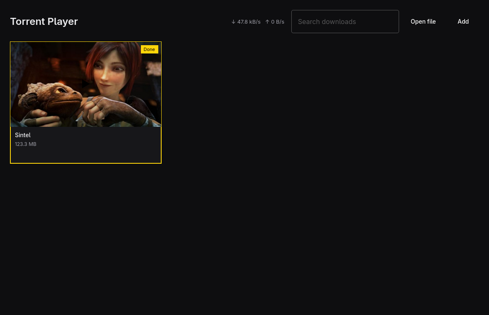

# Torrent Player for Linux



Stream and download torrents on the desktop. Paste a magnet link, pick the
files, and press **Play now**. The video starts while it downloads. Finished
files land in `~/Downloads/Torrent Player`.

It runs the same Rust engine as the Torrent Player Android app (`engine-host`
from `engine-rs`), started in the background and stopped when you quit.

## Install

```sh
bin/install
```

This builds the engine and the app, then installs the package. Torrent Player
then shows up in the app launcher (Super + Space). It also opens magnet links
from the browser and `.torrent` files from the file manager.

The engine is built from the Torrent Player repository. Point the build at it
if it lives somewhere else:

```sh
TORRENTPLAYER_ENGINE_SRC=~/path/to/torrent-player/engine-rs bin/install
```

## Use

- **Add**: press `A`, or `Ctrl+V` with a magnet link copied, or drop a link or
  `.torrent` file on the window.
- **Choose files**: videos and their subtitles start ticked. **Download** keeps
  them, **Play now** opens the player at once.
- **Home**: each card shows progress, speed and peers. Click a card for its
  files and details, or the ▶ on it to play.
- **Player**: seek anywhere (the engine fetches that part first), pick
  subtitles from the torrent, the video, or a file, and pick up where you
  stopped next time. If a format won't play, **Open in mpv** hands the stream to mpv.
- **Remove**: keep the files, or delete them.
- **Settings**: gear on the library header, or `,` / `Ctrl+,`. Closing the
  window hides to the tray; downloads keep going. `Q` or the tray's Quit
  exits fully. Start with `--background` to open in the tray only.

## Keyboard

| Key | Action |
|---|---|
| `?` | Show all shortcuts |
| `A` | Add a magnet link or torrent URL |
| `Ctrl+V` | Add the link on the clipboard |
| `O` | Open a `.torrent` file |
| `,` / `Ctrl+,` | Settings |
| Arrows, `Enter` | Move between downloads, open one |
| `Space` | Play (library), play/pause (player) |
| `P` | Pause or resume a download |
| `Delete` | Remove a download |
| `/` | Search |
| `←` `→` | Back/forward 10 s (`Shift`: 1 min) |
| `↑` `↓` | Volume |
| `M` | Mute |
| `F` | Full screen |
| `C` | Next subtitles |
| `V` | Open in mpv |
| `Esc` | Back |
| `Q` / `Ctrl+Q` | Quit |

## Develop

```sh
bin/build          # engine + app into build/
build/torrentplayer 'magnet:?xt=urn:btih:…'
bin/test           # unit tests, offscreen
```

Data lives in `~/.local/share/torrentplayer` (library, saved `.torrent` files,
thumbnails, and the engine's working files).

## License

MIT for the app; the engine is MPL-2.0. See LICENSE.
